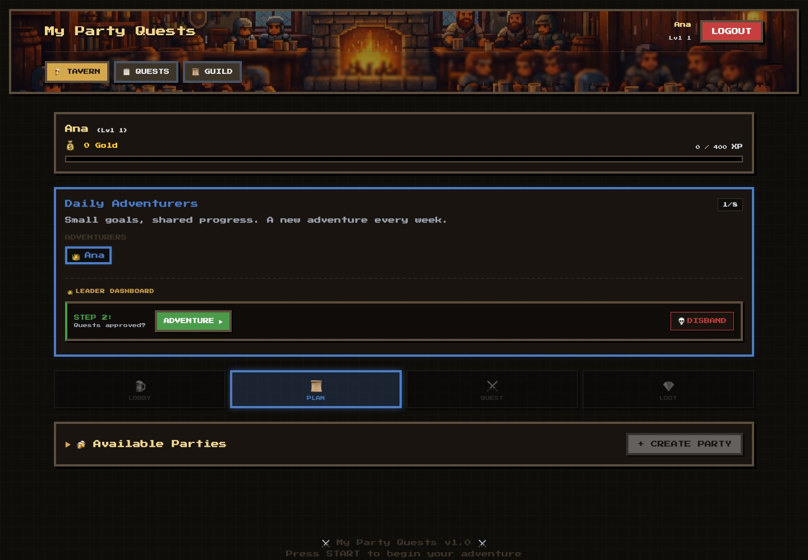
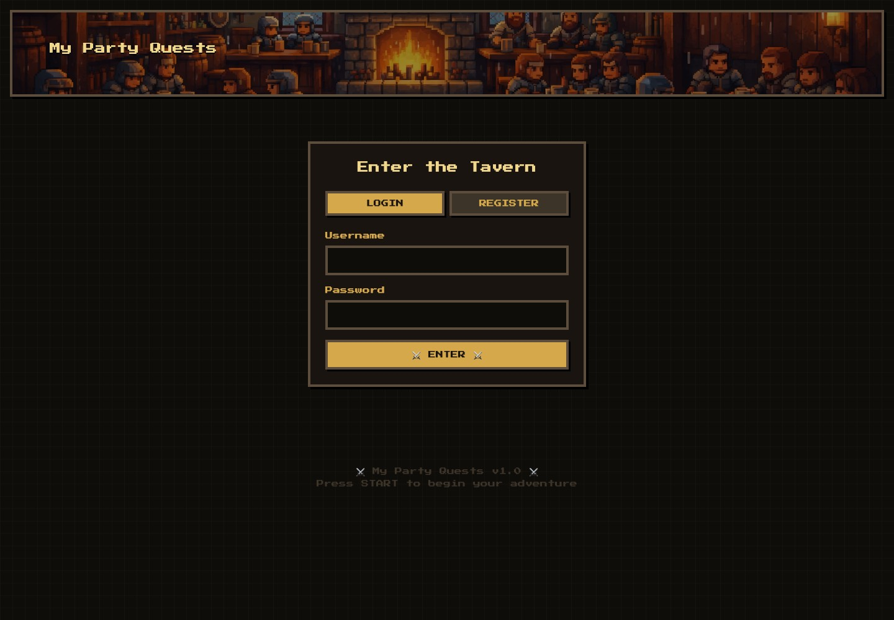
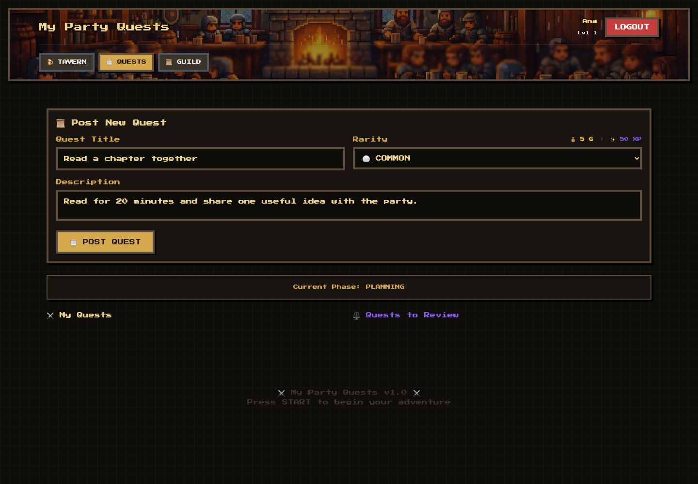
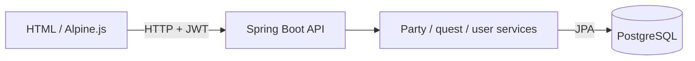

# My Party Quests — Everyday goals as RPG quests

A gamified web application where friends form a party, plan quests and track
progress through an RPG-inspired interface.

**Status:** Portfolio MVP · Personal learning project.

[](https://github.com/ErickHTF/My-Party-Quests/actions/workflows/ci.yml)
   

[Run locally](#run-locally) · [Development guide](docs/development.md) ·
[Architecture](docs/architecture.md) · [API reference](docs/api.md)



| Login                                                 | Quest workspace                                                    |
| ----------------------------------------------------- | ------------------------------------------------------------------ |
|  |  |

_Screenshots show the running application with synthetic local demo data._

## Overview

My Party Quests turns daily routines into shared challenges. A party moves
through planning, execution and review while members manage quests and rewards.

- Create a party and manage membership requests.
- Plan quests with rarity-based XP and gold rewards.
- Review other members' quests and track completion.
- Follow character progression and group rankings.

## Stack

| Layer             | Technologies                                   |
| ----------------- | ---------------------------------------------- |
| Frontend          | HTML, CSS, JavaScript, Alpine.js, Tailwind CSS |
| Backend           | Java 17, Spring Boot 3, Spring Security, JWT   |
| Database          | PostgreSQL 13, Spring Data JPA                 |
| API documentation | Swagger UI, OpenAPI                            |
| Verification      | Maven, JUnit, GitHub Actions                   |

## Run locally

Install **Java 17+**, **Git**, and **Docker with Docker Compose**. Maven is
included through the wrapper.

```bash
git clone https://github.com/ErickHTF/My-Party-Quests.git
cd My-Party-Quests
docker compose up -d
./mvnw spring-boot:run
```

Open [localhost:8080/index.html](http://localhost:8080/index.html), register an account and log in.
The frontend is served by Spring Boot. PostgreSQL uses port `5433`.

See the [development guide](docs/development.md) for database settings and JWT
configuration. The frontend loads Alpine.js, Tailwind and fonts from external
CDNs, so its full presentation requires an internet connection.

## Verification

```bash
./mvnw verify
```

The existing tests cover application startup and token handling. CI starts a
PostgreSQL service for the backend verification.

## Architecture



Spring Boot serves both the static interface and REST API. Controllers delegate
to services and repositories, while Spring Security handles JWT authentication.
Party phases organize the game workflow. Read the
[architecture guide](docs/architecture.md) for the game concepts and source layout.

## Documentation

| Guide                                | Contents                                                   |
| ------------------------------------ | ---------------------------------------------------------- |
| [Development](docs/development.md)   | Local setup, database and JWT configuration                |
| [Architecture](docs/architecture.md) | Party phases, game concepts and package responsibilities   |
| [API reference](docs/api.md)         | API domains and Swagger UI                                 |
| [AWS reference](docs/deployment.md)  | Previous EC2/RDS deployment; infrastructure decommissioned |

## Project context

Built to explore Java backend development and social habit tracking with an RPG
visual identity. The AWS setup is preserved as a reference; that infrastructure
was decommissioned after validation.

No license is currently included in this repository.
